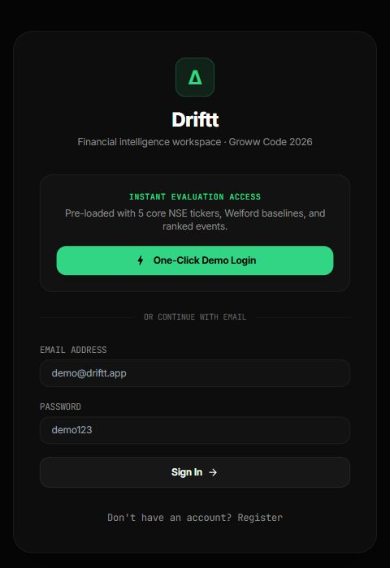

<h1 align="center"> Hi, I'm Gargi</h1>

I build practical AI and full-stack applications, from thoughtful interfaces to reliable APIs. I like turning complex data into something people can understand and use, and I care about showing the evidence behind an answer.

<h2 align="center"> Tech I work with</h2>

<h2 align="center"> Featured projects</h2>

<h3 align="center"><a href="https://github.com/gaaarrrgiiiiiiiiiii/Driftt">Driftt</a></h3>

A market watchlist that highlights what changed since your last visit.

 Demo access screen

<h3 align="center"><a href="https://github.com/gaaarrrgiiiiiiiiiii/Pramana">Pramana</a></h3>

An investigative assistant that connects its findings to source evidence.

 Project landing page

<h2 align="center"> Coding streak</h2>

GitHub may cache this image for several hours. Click the card for the latest available streak. Earlier automated profile commits may be part of the streak history; scheduled profile updates are disabled.

[LinkedIn](https://www.linkedin.com/in/gargi-thapa-089767294/) · [All repositories](https://github.com/gaaarrrgiiiiiiiiiii?tab=repositories)

